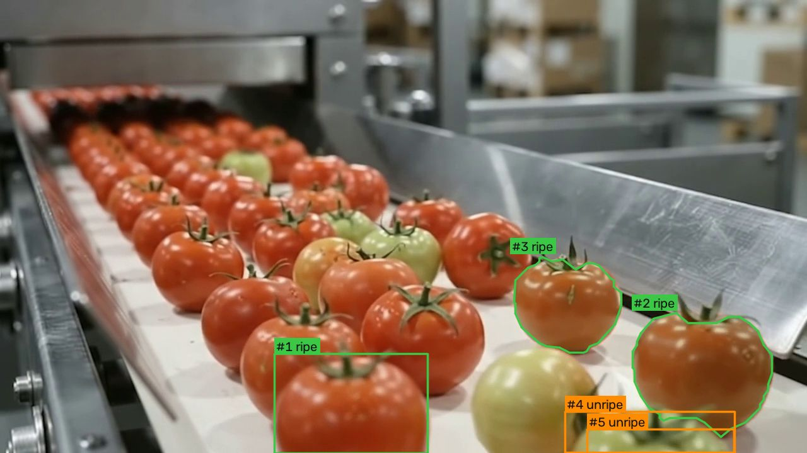

<div align="center">

# TOMATO//SORT AI

**See the tomato. Track its ripeness. Count each track.**

A local computer-vision inspection app with live tomato highlighting, ripe/unripe classification, and a compact monitoring view.

[](https://www.python.org/)
[](https://docs.ultralytics.com/)
[](https://fastapi.tiangolo.com/)
[](https://react.dev/)
[](https://www.typescriptlang.org/)

[Quick start](#quick-start) · [Sample footage](assets/demo/tomato-conveyor.mp4) · [Training notebook](notebooks/TomatoSort_AI_Training.ipynb) · [Report an issue](https://github.com/rcconstante/tomato-sort/issues)

</div>

## Preview



*A frame captured from the running inference stream. Contours are estimated image boundaries, not learned segmentation masks. Track IDs and labels come from the inspection pipeline.*

The dashboard places the video under a simple title bar, with the latest tomato crop and live counts beneath it. Setup, settings, and the inspection log are inside **Setup & controls**. The thin diagonal guide is decorative and has no effect on classification or counting.

The repository includes a [sample conveyor clip](assets/demo/tomato-conveyor.mp4) and [trained weights](backend/models/best.pt), so you can run a local demonstration without training or providing an API key. The clip is illustrative footage, not a labeled accuracy benchmark.

## What it does

- Detects tomatoes with a fine-tuned YOLO11n model and tracks them with ByteTrack.
- Classifies detected tracks as **ripe**, **unripe**, or **uncertain**.
- Logs each track after confirmation, including tomatoes first detected beyond the optional inspection line.
- Offers optional directional line-crossing counting and stricter quality-review checks.
- Draws estimated contours, with bounding-box fallback where a contour is unreliable.
- Records inspection events in SQLite and exports them as CSV.
- Accepts uploaded video, a local video path, a webcam, or an RTSP/HTTP stream.

Sorting is simulated: **ripe → ACCEPT**, **unripe → REJECT**, **uncertain → REVIEW**. The app does not control a physical conveyor or actuator and does not detect rot, damage, or surface anomalies.

## Quick start

Install Python, Node.js/npm, and Git. A CPU is sufficient; an NVIDIA CUDA GPU is optional. Keep both terminal processes below running.

### 1. Clone the repository

```bash
git clone https://github.com/rcconstante/tomato-sort.git
cd tomato-sort
```

### 2. Start the backend

Windows PowerShell:

```powershell
cd backend
python -m venv .venv
.\.venv\Scripts\python.exe -m pip install -r requirements.txt
.\.venv\Scripts\python.exe -m uvicorn app.main:app --host 127.0.0.1 --port 8000
```

macOS/Linux:

```bash
cd backend
python3 -m venv .venv
.venv/bin/python -m pip install -r requirements.txt
.venv/bin/python -m uvicorn app.main:app --host 127.0.0.1 --port 8000
```

For GPU installation, follow the [official PyTorch instructions](https://pytorch.org/get-started/locally/). The app selects CUDA when PyTorch reports it available; otherwise it uses the CPU.

### 3. Start the frontend

In a second terminal, from the repository root:

```bash
cd frontend
npm ci
npm run dev
```

Open [the dashboard](http://localhost:5173). Vite forwards `/api` and `/ws` to the local backend on port 8000.

### 4. Inspect the sample

1. Expand **Setup & controls**.
2. Choose **Upload MP4**, then select `assets/demo/tomato-conveyor.mp4` from your clone.
3. Press **Start**. The latest inspection and totals update from actual inference results.
4. For the default behavior, use **On confirmed detection** and **Simple ripe / unripe**.
5. Turn off **Loop video files** if you want totals from one pass. A replay is counted as a new pass.
6. Use **Reset** to clear the current counters and restart file playback. Previous database records remain available.

For a clean recording view, open [presentation mode](http://localhost:5173/?presentation=1) after starting the source. It hides setup controls, while using the same stream and live data. Return to the normal dashboard to change settings.

## Useful links

| Resource | Link |
|---|---|
| Source repository | [rcconstante/tomato-sort](https://github.com/rcconstante/tomato-sort) |
| Local dashboard | [localhost:5173](http://localhost:5173) |
| Clean presentation view | [localhost:5173/?presentation=1](http://localhost:5173/?presentation=1) |
| Backend health | [localhost:8000/api/health](http://localhost:8000/api/health) |
| Interactive API documentation | [localhost:8000/docs](http://localhost:8000/docs) |
| Open training in Colab | [TomatoSort AI notebook](https://colab.research.google.com/github/rcconstante/tomato-sort/blob/main/notebooks/TomatoSort_AI_Training.ipynb) |
| Dataset version | [Roboflow tomato ripeness v3](https://universe.roboflow.com/ylli-uzfdv/tomato-ripeness-tb3ho/dataset/3) |
| Included weights and metadata | [backend/models](backend/models) |
| Sample video | [tomato-conveyor.mp4](assets/demo/tomato-conveyor.mp4) |
| Issues and feedback | [GitHub Issues](https://github.com/rcconstante/tomato-sort/issues) |

Local links work after you start the app. This repository is a locally run application; it does not provide a hosted public inference service.

## Counting and classification

| Setting | Behavior |
|---|---|
| **On confirmed detection** — default | Logs a track once after at least two observations. A tied class vote can wait for additional observations before becoming uncertain. No line crossing is required. |
| **On inspection-line crossing** | Logs only a track whose center is observed crossing the line segment in the selected direction. Late detections already beyond the line may not be counted. |
| **Simple ripe / unripe** — default | Uses the winning tracked class without the strict confidence-rejection gate. A conservative red/green center-crop check can assist clear cases. |
| **Strict quality review** | Disables color assistance and requires the configured observations, class agreement, and detector confidence. Failed checks become REVIEW. |
| **Processing detail** | Defaults to 512-pixel inference. Higher settings are available but can slow CPU processing. |

The color check operates only inside an existing detection. It does not discover additional objects or measure physical ripeness. Tracks it changes are marked **Color-assisted classification** in their records. Ambiguous colors leave the model prediction unchanged.

The main view deliberately omits confidence percentages. Detector scores and vote diagnostics remain in stored records and CSV exports. A stored detector score is not confidence in an overridden color-assisted class.

Counts are **per track**, not guaranteed unique physical tomatoes. Occlusion or a changed track ID can cause an object to be counted again. Lighting, motion blur, overlap, camera angle, and background colors affect results. More permissive acquisition settings can retain weaker detections but can also increase false detections. The reference-style contour display does not make the model more accurate.

## Optional training

Retraining is not required to run the included model. To train your own:

1. Open the [notebook in Google Colab](https://colab.research.google.com/github/rcconstante/tomato-sort/blob/main/notebooks/TomatoSort_AI_Training.ipynb).
2. Select a GPU runtime, such as T4.
3. Add `ROBOFLOW_API_KEY` in Colab Secrets and enable notebook access. Otherwise, the notebook prompts with hidden input. Never commit the key or notebook outputs containing credentials.
4. Select a published dataset version and run the cells in order. Class names are read from `data.yaml`.
5. Download the exports and replace `backend/models/best.pt` and `backend/models/model_metadata.json`. Reload the model from setup or restart the backend.

The notebook exports `best.pt`, `last.pt`, optional ONNX weights, model metadata, and training metrics. Its readable source is [tools/build_notebook.py](tools/build_notebook.py).

If an export contains only training images, the notebook creates separate local train/validation copies using a seeded source-filename grouping. Roboflow variants sharing the name before `.rf.` stay together, and original downloads remain intact. This does not guarantee separation of renamed duplicates or related video frames. Use a separately captured, source-grouped evaluation set for meaningful final accuracy measurement.

### Recorded validation results

The [included model metadata](backend/models/model_metadata.json) reports:

| Metric | Recorded validation value |
|---|---:|
| Precision | 0.753 |
| Recall | 0.863 |
| mAP@50 | 0.872 |
| mAP@50–95 | 0.616 |

These are recorded validation metrics, not verified conveyor-counting accuracy. No independent test-set metrics are included. Runtime color assistance and counting changes are not represented by those model-validation metrics.

## Stack and architecture

| Layer | Technology |
|---|---|
| Detection | Ultralytics YOLO11n, PyTorch |
| Tracking | ByteTrack with local acquisition configuration |
| Image processing | OpenCV, NumPy, estimated GrabCut/color contours |
| API and live updates | FastAPI, Uvicorn, WebSocket telemetry, MJPEG stream |
| Persistence | SQLite |
| Interface | React, TypeScript, Vite, CSS |
| Training | Google Colab, Roboflow, Ultralytics |

```text
Video / camera / stream
          ↓
YOLO detection → ByteTrack → per-track class votes
          ↓                       ↓
Estimated outlines         counting trigger + grading
          ↓                       ↓
MJPEG video                SQLite events + WebSocket
          └──────────── dashboard ─┘
```

```text
assets/                  Captured inference preview and sample footage
backend/app/             API, model loading, inference, counting, and storage
backend/models/          Included detector and recorded model metadata
backend/tests/           Grading, counting, contour, color, and migration checks
frontend/src/            Compact inspection UI and collapsible setup controls
notebooks/               Google Colab training notebook
tools/                   Notebook generator and dataset-path regression checks
```

## Development checks

From the repository root on Windows:

```powershell
.\backend\.venv\Scripts\python.exe -m pip install pytest pyyaml
.\backend\.venv\Scripts\python.exe -m pytest -q backend/tests
.\backend\.venv\Scripts\python.exe -X utf8 -m unittest discover -s tools -p test_notebook_dataset.py
npm --prefix frontend run build
```

Use the matching `.venv/bin/python` path on macOS/Linux. Regenerate the notebook after editing its source with `python tools/build_notebook.py`.

The frontend build performs TypeScript checking. Backend checks cover line and detection counting, late unripe detections, count-once behavior, grading, existing-record migrations, color assistance, and contour fallback.

## Configuration and API

| Environment variable | Purpose |
|---|---|
| `TOMATOSORT_MODEL` | Override the path to `best.pt`; metadata is read from the same folder. |
| `TOMATOSORT_DATA` | Override the directory for SQLite, uploads, and saved settings. |
| `TOMATOSORT_BACKEND` | Backend URL used by the Vite development proxy. Default: `http://127.0.0.1:8000`. |

| Endpoint | Purpose |
|---|---|
| `GET /api/health`, `GET /api/model` | Health and installed-model information |
| `POST /api/upload` | Upload a supported video |
| `POST /api/session/start` | Start a source with `type` and `value` |
| `POST /api/session/pause`, `/resume`, `/stop`, `/reset` | Playback and session controls |
| `GET/PATCH /api/settings` | Inspection configuration |
| `POST /api/model/reload` | Reload local weights |
| `GET /api/stream.mjpg` | Annotated video stream |
| `WS /ws` | Status and new inspection events |
| `GET /api/inspections`, `/api/sessions`, `/api/inspections/export.csv` | Stored records and CSV export |

## Troubleshooting

- **No active source:** expand Setup & controls, upload a video, then press Start. Presentation mode intentionally hides controls.
- **Model not installed:** verify `backend/models/best.pt` exists. The backend refuses inspection rather than substituting fake results.
- **Unripe label but no log:** select On confirmed detection. Line mode requires an observed directional crossing.
- **Counts keep increasing:** turn off Loop video files for a single pass. Track-ID changes can also cause duplicate physical-object counts.
- **Slow inference:** select Fast (512), close other CPU-heavy tasks, try bounding-box display, or use a supported CUDA installation. There is no guaranteed frame rate.
- **Outlines merge with the background:** switch to Bounding box. Estimated contours are sensitive to color and occlusion.
- **Backend offline:** start Uvicorn on port 8000 and Vite on port 5173. For another backend address, set `TOMATOSORT_BACKEND` before starting Vite.

## Data and licensing

The local app stores uploaded clips, settings, and inspection records under `backend/data/`. These runtime files and secrets are excluded from Git. Inference uses local weights; a Roboflow key is only needed for the optional training download.

Run the server on localhost as shown. It has no authentication layer and is intended for a trusted local environment.

Third-party code, model tooling, and dataset rights remain subject to their own licenses. Review the [Ultralytics licensing terms](https://www.ultralytics.com/license) and the [dataset page](https://universe.roboflow.com/ylli-uzfdv/tomato-ripeness-tb3ho) before redistribution or commercial use. This repository does not add a separate project license.
